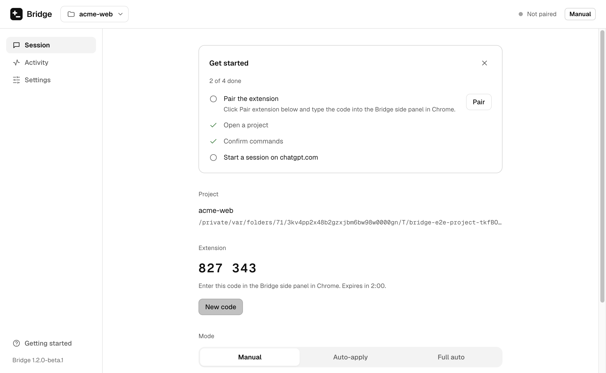
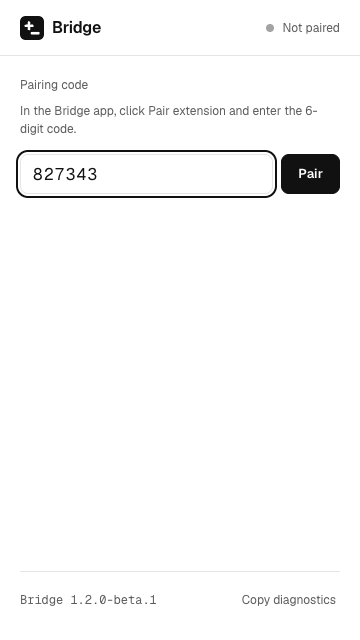
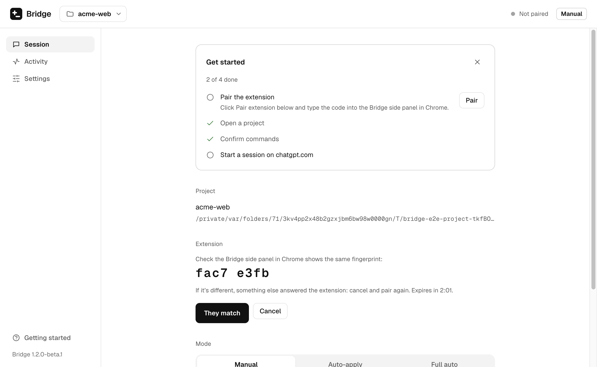
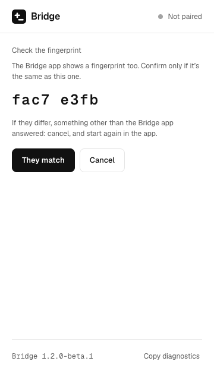

# Testing the Bridge beta

Thanks for helping test Bridge. This page walks you through installing it, what to try (about 15 minutes), and how to tell us what went wrong.

**What Bridge does:** it lets the chat on chatgpt.com suggest changes to files on your computer, and shows each change as a card you can apply or undo. It has two parts that work together:

- the **Bridge app**, which you install on your computer, and
- the **Bridge extension**, which you add to Chrome (or Edge or Brave).

They only talk to each other, on your own computer. Nothing is sent anywhere else.

> This is a **beta**: a test version. Use it on a practice folder, not on work you can't afford to lose. Bridge backs up every file before changing it, but betas can have rough edges.

**Contents:** [What you need](#what-you-need) · [1. Download](#1-download) · [2. Install the app](#2-install-the-app) ([macOS](#macos) · [Windows](#windows) · [Linux](#linux)) · [3. Add the extension](#3-add-the-extension) · [4. Pair them](#4-pair-the-app-and-the-extension) · [5. What to test](#5-what-to-test-about-15-minutes) · [Tips for Free and Go plans](#tips-for-free-and-go-plans) · [Known issues](#known-issues) · [How to report a problem](#how-to-report-a-problem) · [Uninstall completely](#uninstall-completely)

## What you need

- A computer with macOS, Windows 10 or 11 (64-bit), or 64-bit Linux.
- Google Chrome, Microsoft Edge or Brave.
- A chatgpt.com account. A free one works (see [Tips for Free and Go plans](#tips-for-free-and-go-plans)).
- A practice folder to try it on: a copy of a small project, or a new folder with a couple of text files in it.

## 1. Download

Open the [Releases page](https://github.com/jpsoriaga/bridge/releases) and find the newest version marked **Pre-release**, with "beta" in its name (for example **Bridge 1.2.0-beta.1**). Under **Assets**, download:

- **the app** for your computer:

  | Your computer                        | File to download                            |
  | ------------------------------------ | ------------------------------------------- |
  | Mac with Apple silicon (M1 or later) | `Bridge-1.2.0-beta.1-mac-arm64.dmg`         |
  | Mac with an Intel processor          | `Bridge-1.2.0-beta.1-mac-x64.dmg`           |
  | Windows                              | `Bridge-1.2.0-beta.1-win-x64-setup.exe`     |
  | Linux                                | `Bridge-1.2.0-beta.1-linux-x86_64.AppImage` |

- **the extension:** `bridge-extension-1.2.0-beta.1-unpacked.zip` (the same file for everyone).

The numbers in the file names match the version you picked.

## 2. Install the app

Your computer will warn you before opening Bridge the first time. That's expected: the beta isn't "signed", which means it doesn't carry a paid certificate from Apple or Microsoft that tells your computer who made it. The steps below tell your computer you trust this download.

### macOS

**Which Mac do you have?** Click the Apple menu (top left of the screen) → **About This Mac**.

- If it says **Chip: Apple M1** (or M2, M3, M4…), download the **arm64** file.
- If it says **Processor: … Intel …**, download the **x64** file.

**Install:**

1. Open the `.dmg` file you downloaded.
2. Drag **Bridge** into the **Applications** folder.
3. Close the window and eject the "Bridge" disk in Finder's sidebar.

**Open it the first time:**

1. Open your **Applications** folder. **Don't double-click Bridge.** Instead, **right-click** it (or hold Control and click) and choose **Open**.
2. A message asks if you're sure. Click **Open**. macOS remembers this, so next time you can open Bridge normally.
3. On newer macOS (15 Sequoia and later) the message may only offer **Done**. Click it, then open **System Settings → Privacy & Security**, scroll down to "Bridge was blocked…", click **Open Anyway**, and confirm with your password.

**If macOS says "Bridge is damaged and can't be opened":** the app isn't damaged; macOS says this about apps downloaded from the internet that aren't signed. Open the **Terminal** app (in Applications → Utilities), paste this line, press Return, then open Bridge again:

```bash
xattr -dr com.apple.quarantine /Applications/Bridge.app
```

That removes the "downloaded from the internet" mark from Bridge only.

### Windows

1. Double-click `Bridge-…-win-x64-setup.exe`.
2. A blue box may say **"Windows protected your PC"**. Click **More info**, check the name says Bridge, then click **Run anyway**.
   This is Microsoft Defender SmartScreen. It warns about any program from a publisher it doesn't know yet, and an unsigned beta has no publisher name. It isn't a virus warning.
3. Follow the installer. It installs for your user only and doesn't need an administrator password.
4. Open **Bridge** from the Start menu.

### Linux

1. Make the AppImage runnable, then start it. In a terminal, in the folder where you downloaded it:

   ```bash
   chmod +x Bridge-*-linux-x86_64.AppImage
   ./Bridge-*-linux-x86_64.AppImage
   ```

   (Or right-click the file → **Properties** → **Permissions** → tick **Allow executing file as program**, then double-click it.)

2. If nothing happens and the terminal mentions **FUSE**, install it: `sudo apt install libfuse2` on Ubuntu 22.04, or `sudo apt install libfuse2t64` on Ubuntu 24.04.
3. **Ubuntu 24.04 and later:** if Bridge doesn't open and the terminal says _"The SUID sandbox helper binary was found, but is not configured correctly"_, Ubuntu's AppArmor is blocking the security sandbox Bridge runs in. To allow it until you restart the computer:

   ```bash
   sudo sysctl -w kernel.apparmor_restrict_unprivileged_userns=0
   ```

   Then start Bridge again. You'll need to run that line again after each restart. (To make it stick, put `kernel.apparmor_restrict_unprivileged_userns=0` in `/etc/sysctl.d/60-bridge.conf`. That relaxes the rule for every app, not just Bridge; delete the file to undo it.)
   **Don't** start Bridge with `--no-sandbox`: that turns off a protection instead of fixing the cause.

When Bridge opens you'll see its **Session** page with a short **Get started** checklist.

## 3. Add the extension

1. **Unzip** `bridge-extension-…-unpacked.zip` into a folder you'll keep, for example `Documents/Bridge extension`. Your browser loads the extension from this folder every time it starts, so don't delete or move it.
2. Open your browser's extensions page by typing this in the address bar:
   - Chrome: `chrome://extensions`
   - Edge: `edge://extensions`
   - Brave: `brave://extensions`
3. Turn on **Developer mode** (a switch at the top right; in Edge it's in the left sidebar).
4. Click **Load unpacked** and choose the folder you unzipped (the one that contains `manifest.json`).
5. **Pin the icon:** click the puzzle-piece icon next to the address bar, then the pin next to **Bridge**. Now the Bridge icon stays in your toolbar.
6. If you already had chatgpt.com open, reload that tab.

Click the Bridge icon to open the **side panel** on the right. The bottom of the panel shows the version (it should say the same beta version as the app).

Your browser may now and then remind you that you have developer-mode extensions turned on. That's normal for extensions loaded this way; keep Bridge on.

## 4. Pair the app and the extension

Pairing introduces the two to each other, once. After that they reconnect on their own.

1. In the **Bridge app**, click **Pair extension**. It shows a 6-digit code (it works once and expires after 2 minutes).

   

2. In the **side panel**, type the code and click **Pair**.

   

3. **Check the fingerprint.** Both the app and the side panel now show a short code of letters and numbers, like `a1b2 c3d4`. **They must be exactly the same.**

   | In the app                                                                      | In the side panel                                                                             |
   | ------------------------------------------------------------------------------- | --------------------------------------------------------------------------------------------- |
   |  |  |
   - If they match: click **They match** in the **app first**, then **They match** in the side panel.
   - If they differ: click **Cancel** in both and start again. A different fingerprint means something other than your Bridge app answered. If it happens twice, tell us (see [How to report a problem](#how-to-report-a-problem)).

4. Both now say **Connected**.

## 5. What to test (about 15 minutes)

Tick these off as you go, and note anything that surprised you, even small things. If a step doesn't work, copy the diagnostics right away (see [How to report a problem](#how-to-report-a-problem)) and carry on with the next one.

- [ ] **Pair** the app and the extension (above). Did the fingerprints match?
- [ ] **Open a project.** In the app, click **Open folder…** and choose your practice folder. The app's top bar shows its name, and so does the side panel.
- [ ] **A manual edit, then undo it.**
  1. Open a new chat on chatgpt.com. In the side panel, click **Start session**. Bridge puts instructions into the chat's message box; press send yourself.
  2. Ask for a small change, for example: _"Add a line at the end of README.md that says Hello from Bridge."_
  3. When the reply finishes, a card with the change appears under it. Click **Apply**. Check the file changed.
  4. Click **Undo** on the card. Check the file is back as it was. The app's **Activity** page lists both.
- [ ] **Run a command.**
  1. In the app, go to **Settings → Commands**. It suggests some commands for your folder; tick the ones you're happy with and click **Allow**. (In a folder without a `package.json`, `git status` is a good one, if the folder is a git repository.)
  2. Ask the chat: _"Run git status."_ (or one of the commands you allowed).
  3. A command card appears. Click **Run**, watch the output, then **Send output**. It goes into the message box; you press send.
- [ ] **Auto-apply.** In the app, switch the mode to **Auto-apply**. Ask for another small change. It should apply by itself when the reply finishes, with an **Undo** on the card. Undo it.
- [ ] **A short Full auto run.**
  1. In the app, go to **Settings → Full auto** and set the step limit to **3**.
  2. Switch the mode to **Full auto**. Read the warning, then confirm.
  3. Ask: _"Create a file notes.txt with one line in it, then run git status, then finish."_ (use a command you allowed). Bridge applies the change, runs the command and sends the next message itself.
  4. It should stop on its own when the chat says it's done, or at 3 steps. Try **Stop** too (in the side panel, on the page, or in the app).
  5. Switch back to **Manual** when you're done.
- [ ] **New in 1.3.0: a dev server.** In a project with a `dev` script (a Vite or Next.js app is ideal), open **Settings → Commands** and make sure `npm run dev` (or your manager's version) is allowed with **Background** ticked. Ask the chat: _"Start the dev server."_ Click **Start** on the card. It should say **running** with an address; click the address to open it. The app's Session page and the side panel list it too. Then ask the chat to stop it, or click **Stop**.
- [ ] **New in 1.3.0: images.** Ask the chat to make an image for the project, saved as `public/hero.png`. Under the image, a **Save to project** card should show that path; click **Save**, check the file, then **Undo**. In the side panel, under **Send files**, click **Attach** next to a png or jpg in your project: it should appear on the chat's message as an attachment (don't send it if you don't want to).
- [ ] **New in 1.3.0: a download.** Ask the chat to download an icon into your project from an https address. Nothing happens until you click **Download** on its card, even in Full auto.
- [ ] **Sleep and wake.** With everything connected, put your computer to sleep for a minute or two (close the lid, or Sleep from the menu), then wake it. Within about a minute the side panel should say **Connected** again without you doing anything. For extra credit, do this in the middle of a Full auto run and see whether it carries on.

When you're done, send us a quick note even if everything worked: which computer you used, and which steps went fine.

## Tips for Free and Go plans

The chat's Free and Go plans limit how many messages you can send in a few hours. Full auto sends a message for every step, so it uses up that allowance quickly, and the chat may switch to a smaller model or pause you partway through.

- Use **Manual** or **Auto-apply** for most of your testing. You decide when each message goes.
- For the Full auto test, keep the step limit low (3 is plenty) and ask for something small. Avoid **Unlimited** on these plans: every step is one of your messages.
- If the chat says you've reached a limit, Full auto pauses and says so. That's a fine thing to report too.

## Known issues

- **Warnings when opening the app** on macOS and Windows: the beta isn't signed (see [Install the app](#2-install-the-app)).
- **Update notices.** On Windows and Linux, **Settings → About → Update channel** is set to **Beta**, so **Check for updates** tells you when a newer beta (or the final release) is out. It never downloads anything; it links to the Releases page. On macOS, update checks are off in unsigned builds, so the app can't tell you: the person who invited you will, or watch the [Releases page](https://github.com/jpsoriaga/bridge/releases).
- **Updating the extension is manual.** Unzip the new version over the same folder, then click the reload icon on Bridge's card in your browser's extensions page. Update the app and the extension together; if one is older, both say which one to update.
- **Linux:** Ubuntu 24.04's AppArmor setting needs the workaround above.
- **After sleep** it can take up to a minute to reconnect.
- **If the chat page changes** its layout, cards may stop appearing and the side panel says "Bridge can't read this page layout". Please report it with the diagnostics.
- **Images the chat makes** are read from the chat page. If the page serves an image in a way Bridge can't read, the Save card says so; download it from the chat and add it yourself.
- **Dev servers stop** when the session ends, you switch projects, quit Bridge, or the computer sleeps for more than 30 minutes. Start them again from the chat.
- **Full auto** clicks the chat's send button for you. Automating the chat this way may break its provider's terms of use, and the commands it runs execute code the chat may have written. It's opt-in, and the app asks every time you turn it on.

## How to report a problem

### 1. Copy the diagnostics

Diagnostics are a short block of text that helps us see what happened. They contain the versions, your system, the browser version, the mode, the connection state and the last 50 lines of Bridge's log. They **never** contain your files, passwords, keys or tokens: likely secrets are removed, and folder paths start at `~` (your home folder) instead of your user name.

- **In the app:** **Help → Copy diagnostics** (or **Settings → About → Copy diagnostics**). A message confirms it's copied.
- **In the side panel:** **Copy diagnostics**, at the bottom.

Please copy both if you can, since each side knows different things. Paste them anywhere to read them first.

The app also keeps a log file. **Help → Open logs folder** shows it (`bridge.log`, plus up to two older ones).

### 2. Send it to us

- **With a GitHub account:** open a [Beta bug report](https://github.com/jpsoriaga/bridge/issues/new?template=beta-bug-report.yml) for something that went wrong, or [Beta feedback](https://github.com/jpsoriaga/bridge/issues/new?template=beta-feedback.yml) for anything else. The bug report asks for your computer, the version, what you did, what happened, what you expected, and the diagnostics.
- **Without a GitHub account:** send the diagnostics to the person who invited you, with a few lines on what you did, what happened, and what you expected.

A screenshot helps too (crop out anything private). Please don't paste the contents of private files.

If you think you found a **security** problem, don't post it publicly: tell the person who invited you, or use [Report a vulnerability](https://github.com/jpsoriaga/bridge/security/advisories/new) on GitHub.

## Uninstall completely

First, click **Unpair** in the app (or in the side panel). Then remove the extension: open your browser's extensions page (`chrome://extensions`, `edge://extensions` or `brave://extensions`), click **Remove** on Bridge, and delete the folder you unzipped it into.

Then remove the app and its data. The data folder holds Bridge's settings, its pairing key, the backups of files it changed, and its logs. Bridge never writes anywhere else except the folders you opened with it.

### macOS

1. Quit Bridge (Bridge menu → **Quit Bridge**).
2. Drag **Bridge** from **Applications** to the Trash.
3. In Finder, choose **Go → Go to Folder…**, paste `~/Library/Application Support/Bridge`, and move that folder to the Trash.
4. Optional: open **Keychain Access**, search for **Bridge Safe Storage**, and delete it.
5. Empty the Trash.

### Windows

1. Quit Bridge.
2. Open **Settings → Apps → Installed apps**, find **Bridge**, click **…** → **Uninstall**.
3. Paste `%APPDATA%\Bridge` into File Explorer's address bar and delete that folder. (The uninstaller leaves it, so a reinstall would keep your backups.)

### Linux

1. Quit Bridge and delete the `.AppImage` file.
2. Delete the data folder: `rm -rf ~/.config/Bridge`
3. If you made the AppArmor change permanent, delete `/etc/sysctl.d/60-bridge.conf` (`sudo rm /etc/sysctl.d/60-bridge.conf`).
