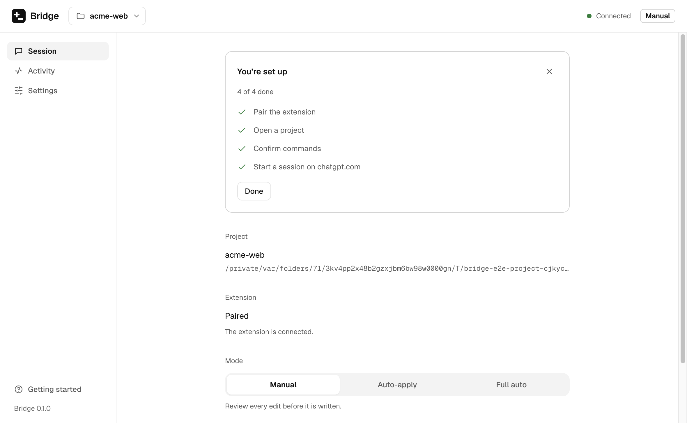
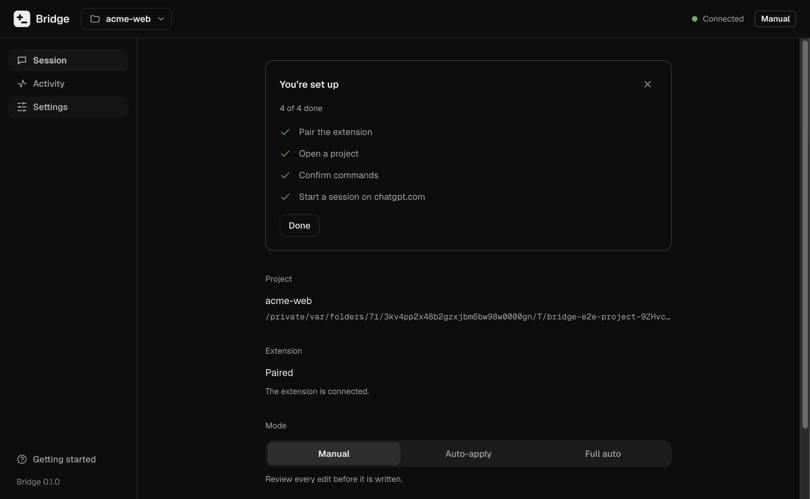
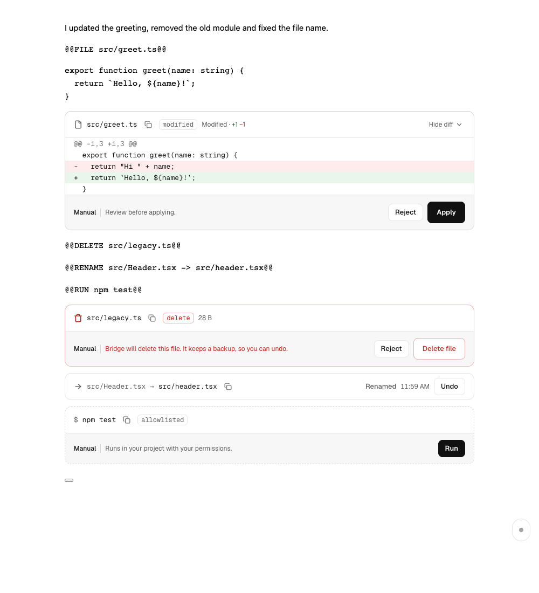
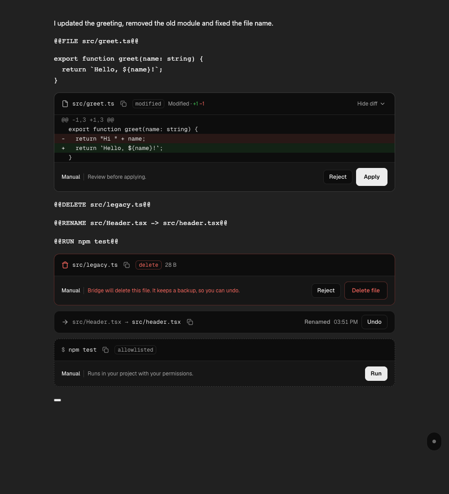

# Bridge


Bridge lets the chat on chatgpt.com edit a project on your computer, with you in charge. The chat writes whole files in a simple `@@FILE` format; Bridge shows each one as a diff card right under the reply, and writes it into your project only when you click **Apply** (or, if you choose, as soon as the reply finishes, with Undo).

Everything runs on your computer. The Bridge desktop app does the reading and writing inside one project folder; the Chrome extension talks only to that app, over `127.0.0.1`. No accounts, no telemetry, nothing sent anywhere else.

> Bridge is not affiliated with or endorsed by OpenAI.

| Light                                                                                                   | Dark                                                                          |
| ------------------------------------------------------------------------------------------------------- | ----------------------------------------------------------------------------- |
|                          |  |
|  |                       |

More in [`docs/screenshots/`](docs/screenshots): the Activity and Settings pages and the side panel, in both themes.

**Contents:** [How it works](#how-it-works) · [Install the app](#install-the-app) · [Install the extension](#install-the-extension) · [Pair](#pair-the-extension) · [Open a project](#open-a-project) · [Use it in the chat](#use-it-in-the-chat) · [Modes](#modes) · [Commands and the allowlist](#commands-and-the-allowlist) · [Full auto](#full-auto) · [Updates](#updates) · [Troubleshooting](#troubleshooting) · [Where data lives](#where-data-lives) · [Uninstall](#uninstall) · [Development](#development) · [FAQ](docs/FAQ.md) · [Security](SECURITY.md) · [Privacy](PRIVACY.md)

## How it works

```
chatgpt.com ──▶ Bridge extension ──WebSocket on 127.0.0.1──▶ Bridge app ──▶ your project
  @@FILE blocks   reads replies, shows diff cards            sandboxed writes, undo,
                  side panel                                 allowlisted commands
```

1. **Start session** (in the extension's side panel) puts short instructions and your project's file list into the chat's message box. You send it.
2. The chat replies with whole files:

   ````
   `@@FILE src/hooks/useTheme.js@@`
   ```js
   ...the full file...
   ```
   ````

   or asks to see files (`` `@@READ src/app.ts@@` ``), to delete or move one (`` `@@DELETE src/old.ts@@` ``, `` `@@RENAME src/a.ts -> src/b.ts@@` ``), or to run a command (`` `@@RUN pnpm test@@` ``).

3. The extension shows a card under each one: a diff against your file, the files asked for, the command. If the chat slips out of the format, the reply gets a card saying so, with **Send format reminder**.
4. You click **Apply** (or **Send these files**, **Run**…). The app checks the path against the project sandbox, backs up the old file, and writes the new one. Every change can be undone.
5. **Modes** decide how much happens on its own: Manual, Auto-apply, or the opt-in Full auto.

[PLAN.md](PLAN.md) has the full architecture, and [SECURITY.md](SECURITY.md) the threat model, every control and the known limits.

## Install the app

Download the installer for your system from the [latest release](https://github.com/jpsoriaga/bridge/releases/latest). `SHA256SUMS.txt` on the same page lets you check the download (`shasum -a 256 <file>` on macOS and Linux, `certutil -hashfile <file> SHA256` on Windows).

| System                     | File                                 |
| -------------------------- | ------------------------------------ |
| macOS, Apple silicon (M1…) | `Bridge-X.Y.Z-mac-arm64.dmg`         |
| macOS, Intel               | `Bridge-X.Y.Z-mac-x64.dmg`           |
| Windows 10 or 11 (64-bit)  | `Bridge-X.Y.Z-win-x64-setup.exe`     |
| Linux (64-bit)             | `Bridge-X.Y.Z-linux-x86_64.AppImage` |

### Unsigned builds

Signing an app costs a yearly fee to Apple and to a Windows certificate authority. Until Bridge's releases are signed (the release notes say whether they are), macOS and Windows warn before running it, because they can't tell who made it. The steps below tell them you trust this download. Check its SHA-256 first if you want to be sure it's the file from the release page.

### macOS

1. Open the `.dmg` and drag **Bridge** to **Applications**.
2. **Unsigned build:** the first time, don't double-click. In Applications, **right-click (or Control-click) Bridge → Open**, then **Open** in the dialog. macOS remembers the choice.
   On macOS 15 (Sequoia) and later the dialog may only offer **Done**: then open **System Settings → Privacy & Security**, scroll to "Bridge was blocked…", click **Open Anyway**, and confirm.
   This is needed because the app isn't notarized by Apple, so Gatekeeper can't check it. A signed build opens normally.
3. Bridge opens to the **Session** page with a **Get started** checklist. Keep it in the Dock if you like.

### Windows

1. Run `Bridge-X.Y.Z-win-x64-setup.exe`. It installs for your user only (in `%LOCALAPPDATA%\Programs\Bridge`), with no admin rights.
2. **Unsigned build:** Microsoft Defender SmartScreen says "Windows protected your PC". Click **More info**, check the file name, then **Run anyway**. SmartScreen warns about programs without a known publisher signature; it isn't a virus warning.
3. Bridge is in the Start menu.

### Linux

1. Make the AppImage executable and run it:

   ```bash
   chmod +x Bridge-X.Y.Z-linux-x86_64.AppImage
   ./Bridge-X.Y.Z-linux-x86_64.AppImage
   ```

2. AppImages need FUSE 2 (`sudo apt install libfuse2` on Ubuntu 22.04, `libfuse2t64` on 24.04). Without it, run with `--appimage-extract-and-run`.
3. On Ubuntu 24.04 and later, AppArmor may stop Electron's sandbox from starting ("The SUID sandbox helper binary was found, but is not configured correctly"). See [Troubleshooting](#troubleshooting).

## Install the extension

- **Chrome Web Store:** _link coming after the first review_ (Bridge is being submitted). Click **Add to Chrome**.
- **Load unpacked** (works today):
  1. Download `bridge-extension-X.Y.Z-unpacked.zip` from the [latest release](https://github.com/jpsoriaga/bridge/releases/latest) and unzip it into a folder you'll keep (Chrome loads it from there).
  2. Open `chrome://extensions` and turn on **Developer mode** (top right).
  3. Click **Load unpacked** and choose that folder.
  4. Pin Bridge from the puzzle-piece menu, and reload any chatgpt.com tab that was already open.

  To update an unpacked copy, unzip the new version over the same folder and click the reload icon on Bridge's card in `chrome://extensions`.

Works in Google Chrome and other Chromium browsers with side panels (Edge, Brave, Arc). Click the Bridge icon to open the side panel.

The app accepts only Bridge's own extension IDs. The unpacked zip (and a development build) carry a manifest `key` that fixes the ID to `golkpkmancgpgkpfjggoimedcogghhip`; the store version has the store's. The other zip on the release, `bridge-extension-X.Y.Z.zip`, is the store upload: it has no `key`, so loaded unpacked it gets a random ID and **can't pair**.

## Pair the extension

You pair once. After that the extension reconnects on its own whenever both are running.

1. In the Bridge app, click **Pair extension** (on the Session page). It shows a 6-digit code that works once and expires in 2 minutes.
2. Open the Bridge side panel in Chrome, type the code and click **Pair**.
3. **Compare the fingerprint.** The app and the side panel each show a short fingerprint like `a1b2 c3d4`. If they're the same, click **They match** in the app, then **They match** in the side panel. If they differ, something other than the Bridge app answered: click **Cancel** on both and start again.
4. Both show **Connected**.

The fingerprint is what makes pairing safe: the key both sides keep comes from a key exchange, and only the real app can produce the same fingerprint. Confirming without looking gives that up.

To unpair, click **Unpair** in the app or the side panel. After 5 wrong codes, pairing is locked for 60 seconds and the code is cancelled.

If one side is updated and the other isn't, both say which one to update (**Update the Bridge app** or **Update the extension**) instead of failing to connect.

## Open a project

1. In the app, click **Open folder…** (⌘O / Ctrl+O) and choose your project. Bridge reopens it next time; the project switcher in the top bar lists your last 5.
2. The extension can reach only files inside that folder. Bridge refuses absolute paths, `..`, links that lead outside it and files with more than one hard link, and never touches `.git/`, `.env` and `.env.*`, `*.pem`, `*.key`, `id_rsa*` or `node_modules/`. Add your own under **Settings → Project → Protected files**. Refused requests show in **Activity** with a red dot.
3. Every write, delete and rename is backed up first (in Bridge's data folder, never in your project). The **Activity** page lists them: filter, search, click a row to see its diff and **Undo** it. Backups are kept 7 days by default (**Settings → Backups**, 1–90).

Bridge reads and writes UTF-8 text only; other encodings are refused rather than corrupted. If the folder disappears while open, the app says **Project missing** until it's back.

## Use it in the chat

You need the app running with a project open, the extension paired, and a chat open on chatgpt.com.

1. In the side panel, under **Session**, check the size of the instructions and click **Start session**. The text lands in the message box; read it and press send. The panel reads **Session active**.
2. Ask for a change. When the reply finishes, each file gets a card with a diff, `+N −M` and a badge (`new`, `modified`, `unchanged`, `conflict`, `blocked`, `partial?`).
3. **Apply** writes the file, **Reject** dismisses the card, **Undo** puts the old file back. Two or more files get **Apply all**. A block that looks partial (`// ...rest unchanged`) needs a second click.
4. If the file changes on disk after the card appeared, the card shows `conflict` and the new diff before you click.
5. **Deletes and renames** get their own cards and only ever happen on a click, in every mode.
6. When the chat asks for files (`@@READ`), **Send these files** puts them in the message box. Or tick files under **Send files** in the side panel. **Files in context** marks files that changed since you sent them; **Resend changed** sends the new versions.
7. **End session** stops Bridge reading that conversation. Moving the tab to another chat ends it too.

Cards keep their state across reloads. A session belongs to one tab; another tab on the same conversation offers **Move here**.

## Modes

You switch modes in the app; the side panel and every card show the current one. The app enforces it: the extension can only ask.

| Mode           | Edits                                                                          | Commands                                                  | Sending                           |
| -------------- | ------------------------------------------------------------------------------ | --------------------------------------------------------- | --------------------------------- |
| **Manual**     | Diff cards; nothing is written until you click Apply                           | RUN cards: **Run** on a click, **Send output** to the box | You press send                    |
| **Auto-apply** | Written as soon as a reply finishes; each card says **Auto-applied** with Undo | As in Manual                                              | You press send                    |
| **Full auto**  | As in Auto-apply                                                               | Allowlisted commands run on their own                     | Bridge sends the follow-up itself |

In every mode, these wait for your click: deletes and renames, files that look partial, changed on disk, refused by the sandbox or over 1 MB, and **gated files** that can change what a command does (`package.json`, lockfiles, `.npmrc`, CI workflows, git hooks, `Dockerfile`, `Makefile`; add more under **Settings → Gated files**).

Auto-apply carries over between sessions. Full auto doesn't: it turns off when you restart Bridge, start or end a session, unpair or switch projects.

## Commands and the allowlist

The first time you open a project, **Settings → Commands** suggests commands from its `package.json` scripts plus `git status` and `git diff`, and the install command of its package manager (from the lockfile: `npm install`, `pnpm install`, `yarn install` or `bun install`; npm without one), already ticked. Tick the ones you want and click **Allow**. Nothing runs until you do, and nothing in the chat or the extension can change the list.

- **The install command** is an exact entry, with no `*`: it installs only what `package.json` lists, so the chat can't add a package through it, and `npm install <pkg>`, `npm i`, `npx`, `dlx` and `npm create` stay refused. The session prompt asks the chat to run it after changing `package.json`. Installing runs your dependencies' install scripts, but only for packages already in a `package.json` you approved: edits to `package.json` and lockfiles always need your click, in every mode. It gets its own timeout (5 minutes by default, under **Install timeout**). Projects whose list you confirmed before 1.1.0 get a one-time **Add `npm install` to the allowlist?** note with **Add** and **Dismiss**; it's never added without your click.

- An entry matches exactly: `pnpm test` allows `pnpm test` and nothing more. End it with `*` to allow extra arguments (`pnpm test *` also allows `pnpm test -- --run a.test.ts`). Prefer exact entries.
- Some options are refused even with `*`, because they'd let an allowed program run other code or write elsewhere: `git -C`, `-c`, `--output`, …; `node -e`, `-r`, `--import`, …; package managers' `--dir`, `--prefix`, `-g`, `exec`, `dlx`; and `npx`, `pnpx`, `bunx` entirely. The full table is in [SECURITY.md](SECURITY.md).
- There's no shell: pipes, `&&`, redirects, `$`, wildcards and `FOO=1 cmd` are refused.
- Commands run in the project folder with your environment minus anything that looks like a secret, one at a time, with a timeout (2 minutes by default, 5 for the install command) that stops everything they started.
- Likely secrets in command output and file contents are replaced with `[redacted]` before they go into the chat. It's best effort: keep secrets in `.env` files, which Bridge never reads.

The app reads your login shell's `PATH` at startup (macOS, Linux), so `pnpm` from nvm, Volta or Homebrew works even when Bridge is opened from the Dock. **Settings → Commands → PATH for commands** shows where it came from and can override it.

## Full auto

> **Read this before turning it on.** Full auto clicks the chat's send button for you. Automating the chat this way may break its provider's terms of use and put your account at risk. The commands it runs execute code the model may have written (tests, build scripts), with your user's permissions. It's opt-in and at your own risk, and the app asks you to confirm every time you turn it on.

When a reply finishes, Bridge applies its edits, reads the files it asked for, runs its allowlisted commands, and sends one follow-up with the results, then waits for the next reply. It ends when a reply asks for nothing or says `` `@@DONE@@` ``. A reply that misses Bridge's format gets a short reminder instead (twice per run at most; the third time it pauses). It pauses for you on anything that needs a click, a command that isn't allowed, an error banner, a lost connection, or the step limit (10 messages by default, up to 25). **Stop** is in the side panel, on the page chip and in the app (⌘. / Ctrl+.); it halts at once and reverts nothing.

**Sleep and cut-off replies.** When your computer sleeps, Chrome freezes the chat tab mid-reply. On waking, Full auto reconnects and checks the reply: if it's still streaming, it waits ("Waiting for the chat to finish (resumed after sleep)") and carries on when it's done; if it finished meanwhile, it acts on it. A reply that shows as streaming but gets no new text for 60 seconds is stuck: Full auto presses the chat's stop button once on its own, applies what came through whole and asks the chat to continue; if it sticks again, it pauses with **Stop & continue**. A reply cut off by an error or the network has its finished blocks applied (never the file it was writing) and gets one request to continue from the last marker that came through, or the page's own **Continue generating** when it offers one; a second cut in a row pauses with **Resume**. A command running when the computer slept asks **Re-run** or **Skip**. If the conversation, session or project changed meanwhile, Full auto stays paused and says why. Turn **Settings → Full auto → Catch up automatically after sleep** off to pause after sleep and wait for Resume instead. In any mode, a cut-off reply gets a card with **Insert continuation** (and **Continue generating** when the page has it).

## Updates

**Settings → About** shows your version and has **Check for updates**. It asks GitHub Releases for the latest version number and, if there's a newer one, links to it. It never downloads or installs anything. Turn on **Check for updates when Bridge starts** to have it ask once at each launch (off by default). Unsigned macOS builds don't check; watch the [releases page](https://github.com/jpsoriaga/bridge/releases) instead.

To update, install the new version over the old one (drag it to Applications, run the new installer, or replace the AppImage). Your pairing, settings and backups stay. Update the extension too: the store does it on its own; for an unpacked copy, replace the folder and click reload on `chrome://extensions`.

## Troubleshooting

- **macOS: "Bridge can't be opened because Apple cannot check it for malicious software"** or "Bridge is damaged": it's an unsigned build. Use right-click → **Open**, or **Open Anyway** in System Settings → Privacy & Security (see [Install the app](#macos)). If it still says "damaged", the download was quarantined in a way the dialog can't clear: run `xattr -dr com.apple.quarantine /Applications/Bridge.app` once.
- **Windows: "Windows protected your PC"**: **More info → Run anyway** (unsigned build).
- **Linux: the AppImage doesn't start**: install FUSE 2, or run it with `--appimage-extract-and-run`. If it mentions the "SUID sandbox helper", Ubuntu's AppArmor is blocking Electron's sandbox; the quickest fix is `sudo sysctl -w kernel.apparmor_restrict_unprivileged_userns=0` (until reboot), or an AppArmor profile for the AppImage. Don't run it with `--no-sandbox`.
- **Side panel says "App not running"**: open the Bridge app. The extension keeps retrying, and retries at once when you open the side panel.
- **"Update the Bridge app" / "Update the extension"**: the two are on different versions. Update the one named (see [Updates](#updates)).
- **Side panel stays on "Can't reach Bridge"**: the app answered but refused the extension. If you unpaired in the app while Chrome was closed, click **Unpair** in the side panel and pair again. If you loaded the store zip (`bridge-extension-X.Y.Z.zip`) unpacked, its ID is random and the app refuses it: load `bridge-extension-X.Y.Z-unpacked.zip` instead.
- **App says "Server error"**: something else is using every port from 47821 to 47830. Free one and restart Bridge.
- **No cards in the chat**: check the side panel says **Session active** for this tab. Cards appear once a reply has finished. Reload the chat tab if it was open before the extension was installed or updated.
- **"Bridge can't read this page layout"**: the chat page changed in a way this version doesn't recognise. Check for an update.
- **"Reload the page to use it here"**: the extension was updated while the chat was open. Reload the tab.
- **A RUN card says "not allowed"**: add the command under **Settings → Commands** if you want it to run.
- **"That program isn't installed or isn't on the PATH"**: see **Settings → Commands → PATH for commands**; paste the output of `echo $PATH` there if the login shell couldn't be read.
- **Full auto paused with "no new message appeared"**: the page didn't take the send. Check the message box and press **Resume**.
- **"Project missing"**: the folder was moved, renamed or unmounted. Put it back and click **Try again**, or open it from its new place.

More in the [FAQ](docs/FAQ.md).

## Where data lives

**The app** keeps its settings, pairing key and backups in its data folder, readable only by your user:

| System  | Folder                                            |
| ------- | ------------------------------------------------- |
| macOS   | `~/Library/Application Support/Bridge`            |
| Windows | `%APPDATA%\Bridge`                                |
| Linux   | `~/.config/Bridge` (or `$XDG_CONFIG_HOME/Bridge`) |

Inside: `settings.json` (projects, patterns, allowlists, settings), `pairing.json` and `server-key.json` (keys, encrypted with your system keychain when available), and `backups/` (copies of changed files and the change log, per project). A development build (`pnpm dev`) uses `@bridge/desktop` instead of `Bridge`, so it never shares a pairing or backups with an installed app.

**The extension** keeps the pairing key in its own IndexedDB, and session and card states (paths, hashes, counts, never file contents) in Chrome's extension storage. [PRIVACY.md](PRIVACY.md) lists everything.

## Uninstall

1. **Unpair** in the app (or the side panel), so neither side keeps a key the other forgot.
2. Remove the extension: `chrome://extensions` → Bridge → **Remove**. That deletes its storage.
3. Remove the app:
   - **macOS:** quit Bridge, drag `/Applications/Bridge.app` to the Trash, then delete `~/Library/Application Support/Bridge` (Finder → Go → Go to Folder…). Also remove "Bridge Safe Storage" from Keychain Access if you want the keychain entry gone.
   - **Windows:** Settings → Apps → Installed apps → Bridge → **Uninstall**, then delete `%APPDATA%\Bridge` (paste it into Explorer's address bar). The uninstaller leaves that folder so a reinstall keeps your backups.
   - **Linux:** delete the AppImage and `~/.config/Bridge`.

Bridge never writes anything else outside its data folder and the projects you opened.

## Development

Requirements: Node.js 24 (`nvm use` reads `.nvmrc`), pnpm 9.15.4 (`corepack enable`), and Chrome.

```bash
corepack enable
pnpm install
pnpm dev        # the app with hot reload, and the extension rebuilt into apps/extension/dist
```

Load `apps/extension/dist` unpacked (as above). It has the fixed development ID, so it pairs with both `pnpm dev` and installed apps. After a change, click reload on its card in `chrome://extensions` and refresh the chat tab. If `pnpm dev` fails with `electron.app` undefined, your shell has `ELECTRON_RUN_AS_NODE=1`: run `env -u ELECTRON_RUN_AS_NODE pnpm dev`. Development builds also have a **Test read (dev only)** field in the side panel.

| Command                                                  | What it does                                                                                |
| -------------------------------------------------------- | ------------------------------------------------------------------------------------------- |
| `pnpm dev`                                               | Desktop app with hot reload + extension watch build                                         |
| `pnpm build`                                             | Production build of both apps                                                               |
| `pnpm lint` / `pnpm format` / `pnpm format:check`        | ESLint; Prettier                                                                            |
| `pnpm typecheck`                                         | `tsc --noEmit` in every package                                                             |
| `pnpm test` / `pnpm test:coverage`                       | Vitest; with coverage thresholds (CI)                                                       |
| `pnpm version:set X.Y.Z` / `pnpm version:check [vX.Y.Z]` | One version for the app, the extension and shared                                           |
| `pnpm package:mac` / `package:win` / `package:linux`     | Installers in `apps/desktop/dist` (signed if the secrets are set; [RELEASE.md](RELEASE.md)) |
| `pnpm --filter @bridge/desktop check:package`            | Fuses and app.asar contents of the packaged apps                                            |
| `pnpm --filter @bridge/desktop smoke <app>`              | Launches a packaged app and checks its window and `/health`                                 |
| `pnpm build:extension:release`                           | The store zip and the Load unpacked zip in `release/`                                       |

End-to-end scripts (Playwright, against the built app and a stand-in chat page) are in [`e2e/`](e2e/README.md); they use their own ports, so they run alongside `pnpm dev`.

```
apps/
  desktop/          Electron app (electron-vite): src/main, src/preload, src/renderer; scripts/ for packaging
  extension/        Chrome MV3 extension (CRXJS + Vite): manifest.config.ts, src/content, src/background, src/sidepanel
packages/
  shared/           @bridge/shared: types, chat parser and prompts, diff, protocol, logo and icon, design tokens
scripts/            version, extension release zip, changelog notes
store/              Chrome Web Store listing and images
e2e/                Playwright scripts
archive/prototype/  earlier prototype, reference only (not built)
```

## Docs

- [docs/FAQ.md](docs/FAQ.md): common questions
- [SECURITY.md](SECURITY.md): threat model, controls, known limits, reporting a problem
- [PRIVACY.md](PRIVACY.md): what's stored where; no telemetry
- [CHANGELOG.md](CHANGELOG.md) and [RELEASE.md](RELEASE.md): versions, and how a release is cut
- [PLAN.md](PLAN.md), [CHECKLIST.md](CHECKLIST.md), [DESIGN.md](DESIGN.md): architecture, progress, design system
- [CLAUDE.md](CLAUDE.md): working rules for AI coding sessions

## License

[MIT](LICENSE) © Jaypee Soriaga. Bridge is not affiliated with or endorsed by OpenAI.
