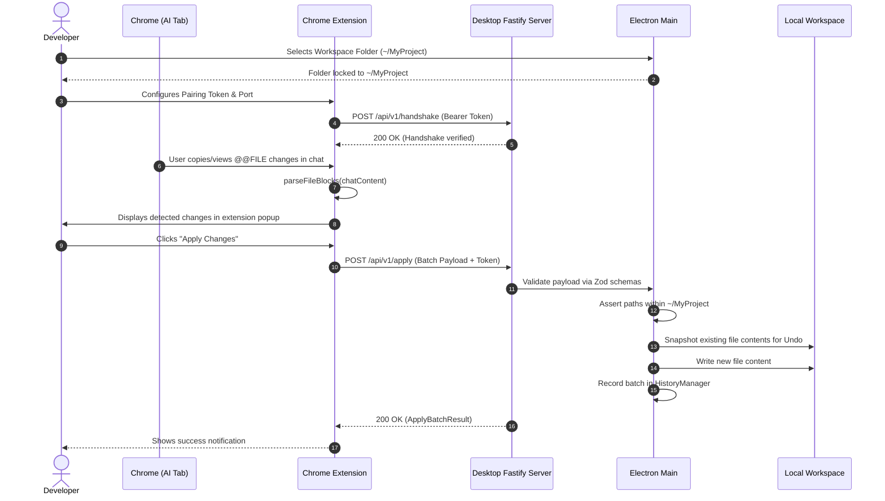

# Bridge Architecture

## 1. System Overview

**Bridge** is a developer tool designed to securely synchronize code changes generated by AI chat interfaces directly into local project workspaces. It consists of three tightly coupled, highly cohesive components organized within a `pnpm` monorepo:

1. **Desktop Application (`apps/desktop`)**: An Electron application that runs locally on the developer's workstation. It controls the local server, manages workspace selection, enforces filesystem boundaries, maintains an undo transaction log, and executes allowlisted diagnostic commands.
2. **Chrome Extension (`apps/extension`)**: A Manifest V3 browser extension that scans AI assistant conversations for structured `@@FILE` change blocks and relays approved payloads to the local desktop application.
3. **Shared Package (`packages/shared`)**: A pure TypeScript package that defines protocol versioning, Zod validation schemas, data transfer types, and the `@@FILE` block parser.

```
┌────────────────────────────────────────────────────────┐
│                   Browser Environment                  │
│  ┌──────────────────────────────────────────────────┐  │
│  │ AI Chat Tab (ChatGPT, Claude, Gemini, etc.)      │  │
│  │ └── DOM rendered @@FILE blocks                   │  │
│  └────────────────────────┬─────────────────────────┘  │
│                           │ Scanned by                 │
│  ┌────────────────────────▼─────────────────────────┐  │
│  │ Chrome Extension (@bridge/extension - MV3)        │  │
│  │ ├── Content Script (DOM block detection)         │  │
│  │ ├── Shared Parser (@bridge/shared)                │  │
│  │ ├── Popup / Options (React UI)                   │  │
│  │ └── Background Service Worker                    │  │
│  └────────────────────────┬─────────────────────────┘  │
└───────────────────────────┼────────────────────────────┘
                            │
               HTTP / Bearer Authentication
               Loopback strictly on 127.0.0.1
                            │
┌───────────────────────────▼────────────────────────────┐
│              Host Workstation Environment              │
│  ┌──────────────────────────────────────────────────┐  │
│  │ Bridge Desktop (@bridge/desktop)                 │  │
│  │                                                  │  │
│  │  ┌────────────────────────────────────────────┐  │  │
│  │  │ Main Process                               │  │  │
│  │  │ ├── Fastify Local Server (127.0.0.1)       │  │  │
│  │  │ ├── SecurityService (Token & Confinement)  │  │  │
│  │  │ ├── FileManager (Atomic writes & backups)  │  │  │
│  │  │ ├── HistoryManager (Rollback stack)        │  │  │
│  │  │ ├── CommandExecutor (Strict allowlist)     │  │  │
│  │  │ └── IPC Handlers                           │  │  │
│  │  └──────────────┬─────────────────────────────┘  │  │
│  │                 │ contextBridge IPC              │  │
│  │                 │ (contextIsolation: true)       │  │
│  │  ┌──────────────▼─────────────────────────────┐  │  │
│  │  │ Preload Script                             │  │  │
│  │  │ └── Narrowly scoped window.bridgeApi       │  │  │
│  │  └──────────────┬─────────────────────────────┘  │  │
│  │                 │                                │  │
│  │  ┌──────────────▼─────────────────────────────┐  │  │
│  │  │ Renderer Process (React UI)                │  │  │
│  │  │ ├── Workspace Selection                    │  │  │
│  │  │ ├── Staged Diff Review & Actions           │  │  │
│  │  │ ├── Activity / Audit Log                   │  │  │
│  │  │ └── Pairing Configuration                  │  │  │
│  │  └────────────────────────────────────────────┘  │  │
│  └──────────────────────────────────────────────────┘  │
│                           │                            │
│  ┌────────────────────────▼─────────────────────────┐  │
│  │ Confined Workspace Root (e.g., ~/SideProject)     │  │
│  │ └── Safe File Reads, Writes, and Deletes          │  │
│  └──────────────────────────────────────────────────┘  │
└────────────────────────────────────────────────────────┘
```

---

## 2. Process Boundaries & Responsibilities

### 2.1 Chrome Extension (`apps/extension`)
- **Thin Client Strategy**: The extension never interacts with the local workstation filesystem directly (Chrome extensions cannot access local disk paths without native host wrappers).
- **DOM Parsing**: Inspects chat DOM elements for `@@FILE` syntax tags or fenced code blocks using the `@bridge/shared` parser.
- **Relay**: Sends validated payloads over loopback HTTP (`http://127.0.0.1:<port>`) with a bearer token.
- **Pairing Storage**: Holds server port and pairing token in `chrome.storage.local`.

### 2.2 Electron Main Process
- **Lifecycle & Services**: Initializes the Fastify server, registers IPC handlers, and orchestrates windows.
- **Filesystem Confinement**: Acts as the gatekeeper for all file writes. Verifies that all target paths resolve within the user-selected workspace root, preventing path traversal and symlink escapes.
- **History & Undo**: Maintains historical file states before mutations. If an applied change causes build issues or mistakes, the developer can undo the entire batch.
- **Command Execution**: Rejects arbitrary shell execution. Restricts executions to explicit commands (such as `git status`, `pnpm test`) with allowlisted argument patterns using `execFile`.

### 2.3 Electron Preload Layer
- **Hardened Boundary**: Runs with `contextIsolation: true` and `nodeIntegration: false`.
- **Exposed Surface**: Exposes only high-level semantic methods to `window.bridgeApi` (e.g. `selectWorkspace`, `getPairingInfo`, `undoLast`).
- **No Direct Shell / FS Access**: The renderer cannot access Node.js `fs`, `child_process`, or arbitrary Electron IPC channels.

### 2.4 Electron Renderer Process
- **Pure React Application**: Bundled via Vite through `electron-vite`.
- **Presentation**: Renders workspace selection, diff inspection, batch apply/discard controls, transaction rollback controls, and security token management.
- **Zero Secrets Storage**: Does not persist pairing credentials; fetches them dynamically via IPC from the main process when the pairing modal is opened.

---

## 3. Shared Package Architecture (`packages/shared`)

The shared package ensures complete type and schema symmetry across both applications:
- **`parser/`**: Multi-format `@@FILE` block extractor supporting tag syntax, action attributes (`[create]`, `[modify]`, `[delete]`), and markdown fenced blocks.
- **`protocol/`**: Version constant (`1.0.0`), compatibility helpers, and message types (`bridge:handshake_request`, `bridge:apply_changes_request`, etc.).
- **`schemas/`**: Zod schemas validating relative path safety (prohibiting null bytes, directory traversal `..`, and absolute roots), handshake envelopes, and batch apply payloads.
- **`types/`**: TypeScript interfaces for `FileChange`, `ApplyBatchResult`, `UndoEntry`, and `ProtocolEnvelope`.

---

## 4. End-to-End Data Flow



---

## 5. Trust Boundaries & Security Model

| Boundary | Communication Channel | Protections |
| :--- | :--- | :--- |
| **Extension to Desktop** | HTTP loopback (`127.0.0.1`) | Bearer token authentication with timing-safe comparison; CORS restricted to `chrome-extension://*`; Loopback only. |
| **Renderer to Main** | Electron `ipcRenderer.invoke` | Context isolation; Node integration disabled; Narrowly scoped API in preload; No arbitrary IPC dispatch. |
| **Desktop to Filesystem** | Node.js `fs/promises` | Strict relative path schema validation; `realpathSync` symlink escape verification; Strict workspace root prefix assertion. |
| **Desktop to OS Shell** | Node.js `child_process.execFile` | Strict allowlist of binaries and subcommands; Disallowance of shell metacharacters (`;&|$\` etc.); No `/bin/sh` or shell invocation. |
